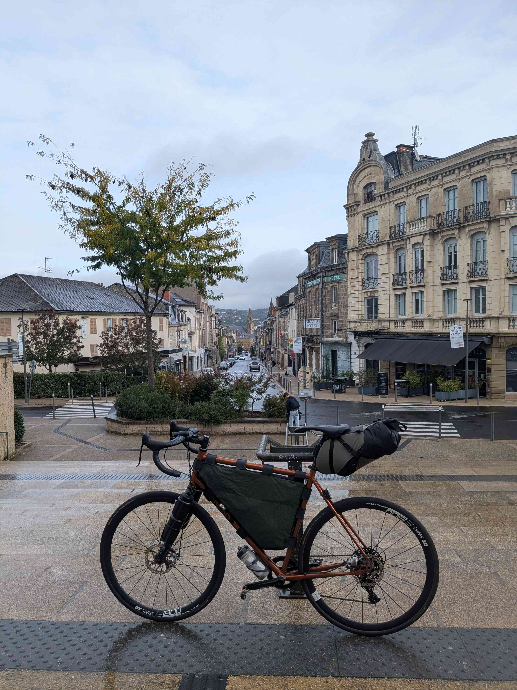
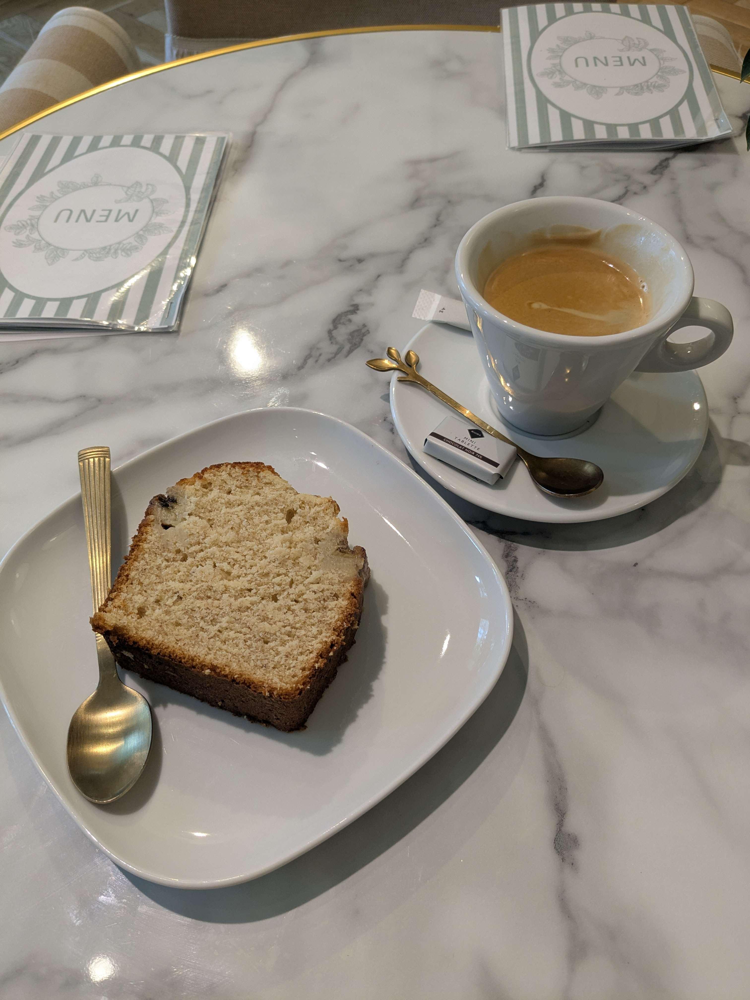
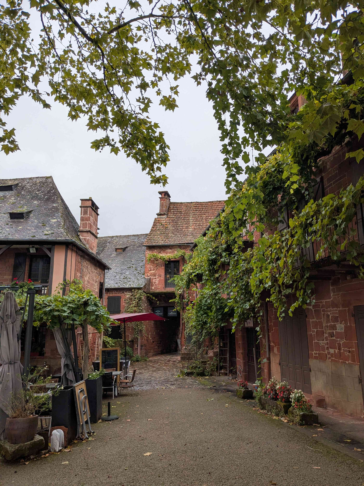
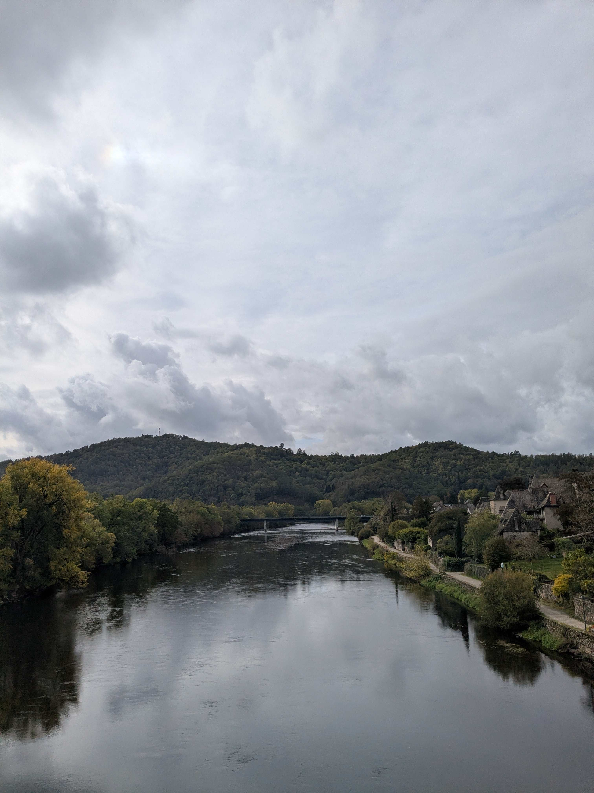

+++
title = "Bordeaux - Pleaux"
date = "2026-10-24"
draft = "false"
+++

Lorsque le réveil sonne, à sept heures ce matin, je me maudis de n'avoir, une fois de plus, pas pris un seul jour de repos avant de partir en voyage, alors que je travaillais hier encore aux alentours de dix-huit heures.

La route est humide et sombre jusqu'à la gare. Je m'installe dans le petit TER à destination de Tulle, qui m'emmène, à grands renforts de tremblements et hésitations en tout genre, à bon port - c'est-à-dire Brive-la-Gaillarde.

Je ne me presse pas pour partir et prends plutôt un petit-déjeuner sur place. La matinée est froide, humide et je connais la terrible montée qui permet de sortir de Brive en direction de Collonges-la-Rouge, que je devrais immanquablement emprunter.

C'est donc avec une tranche de cake et un café dans le ventre que je m'élance sur le bitume détrempé. En quelques minutes je suis maculé de boue du même rouge que celui des pierres de Collonges, qui ont fait sa réputation. Petit arrêt dans le village, dans la seule boutique que je connaisse : celle qui vend des sandwiches.

Alors que je repars, je suis vite doublé par un énorme pickup qui transporte un non moins énorme sanglier. La bête baigne dans son sang que j'imagine encore tiède, et la vision de l'épaisse fourrure maculée de cette glue noire émeut quelque peu mon cœur de citadin endurci. Pas de doute, je suis en Corrèze.






Pas pour longtemps cela dit, au détour d'une exploitation forestière, je bascule dans le Cantal ! Les montées se font plus raides, malheureusement. Alors que je m'arrête dans un petit super U pour acheter quelques barres de céréales (car je suis parti sans rien, pour une fois), je me dis qu'il est temps de réserver un hôtel pour le soir. C'était sans compter sur mon téléphone, que le froid a engourdi et dont la batterie lâche dès le premier coup de fil.

Vent de panique - car il fait très froid et la pluie menace -, je me rends au centre du village pour trouver de l'aide. On m'oriente vers le fleuriste qui "a des contacts". Pas étonnant, car il est aussi maire du village. Il arrive à me trouver _in extremis_ un petit mobil-home dans le camping du coin et, pour dîner : "venez donc à la fête du village, on prépare des lasagnes !".

Que demander de plus ?

