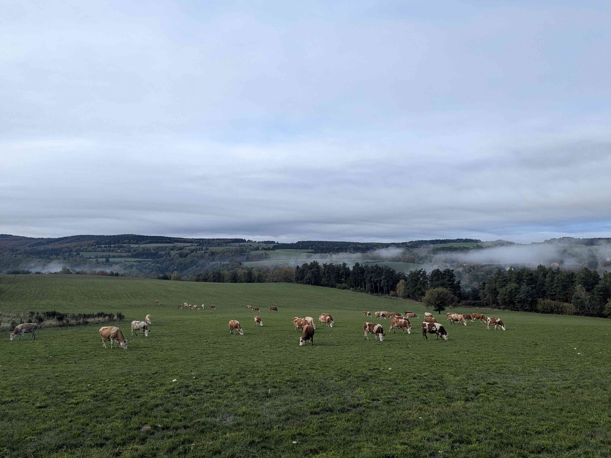
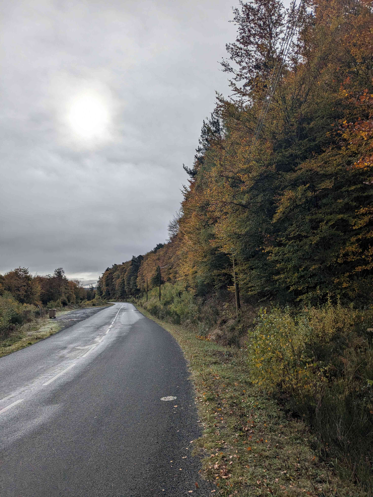
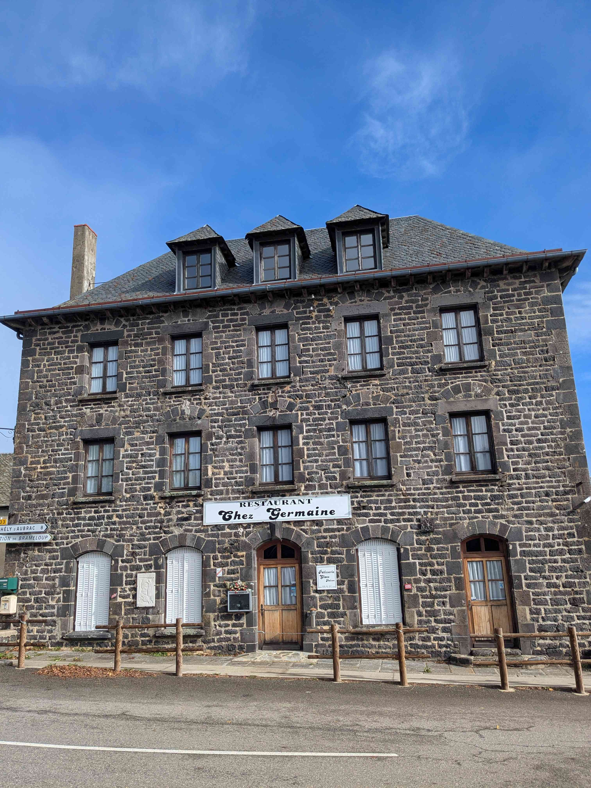
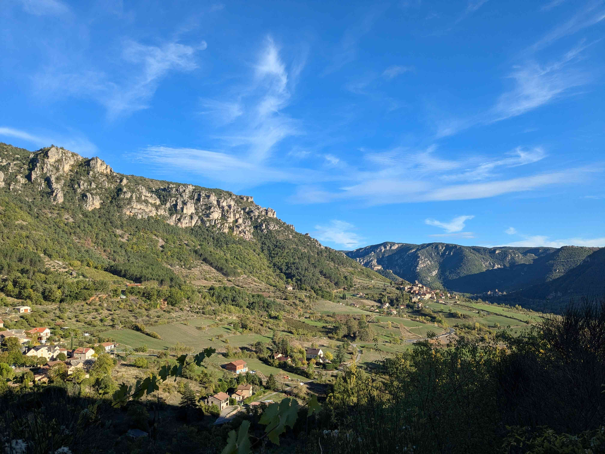
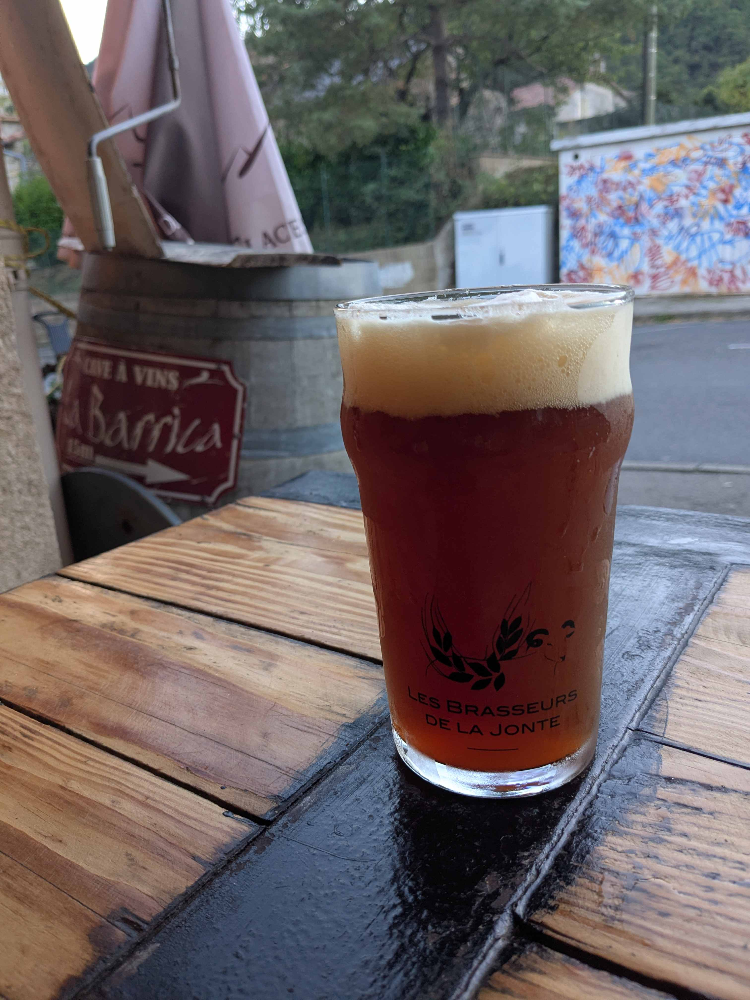

+++
title = "Chaudes-Aigues - Peyreleau"
date = "2026-10-26"
draft = "false"
+++

La ville se noie dans une épaisse vapeur de bon matin ; rencontre entre la fraîcheur glaciale de la nuit et les sources bouillonnantes qui parcourent les caniveaux.

Quant à moi, je me mets en route dans ce brouillard, sur une route sinueuse qui permet de sortir de la cuvette. À condition, bien sûr, d'avoir les jambes pour. Ce n'est pas trop mon cas et je me traîne un peu, d'autant que le froid mordant m'engourdit les muscles.

La montée n'en finit pas, car à peine la sortie de Chaudes-Aigues atteinte, c'est reparti de plus belle, vers le col d'Aubrac. Au-dessus de mille mètres, me voilà de nouveau plongé dans un épais nuage poisseux qui m'oblige à retirer mes lunettes trempées. L'effort est long et ingrat.

Changement de braquet musical aujourd'hui. Je me dis que la douceur âpre des collines de l'Aubrac se prêterait bien à une petite rétrospective Brahms (pourquoi pas ?). En haut du col, lorsqu'enfin je bascule sur les hauts-plateaux, ce n'est autre que le premier mouvement du [concerto pour piano n°2](https://youtu.be/y4YqWXmF9Dg?t=26&is=HMftlKcehufAuO-g) qui se lance et qui m'accompagne dans une belle descente, douce et louvoyante, vers le petit village d'Aubrac. Le plaisir est intense et contraste prodigieusement avec la terne journée d'hier.

Petite pause méritée et visite de l'église, chiche mais charmante. À perte de vue, s'étendent d'immenses pâturages que l'on sent éprouvés par la rudesse de l'été. Tout a brûlé et la grande réserve d'eau que l'on aperçoit au loin a triste mine.







Très longue descente ensuite sur Saint-Geniez-d'Olt, où malheureusement tout est clos en ce lundi. Je déjeune donc sur le parking d'un supermarché. Ce n'est pas glamour, mais cela m'importe peu, mes pensées occupent suffisamment de place pour me faire oublier ce lieu sans âme.






Il semblerait presque facile, ensuite, de rejoindre Peyreleau, dans les gorges du Tarn, où un gîte m'attend. Ce serait néanmoins sans compter sur les nombreuses côtes casse-pattes et abruptes, comme seuls savent en engendrer les plateaux calcaires des Grands Causses.

Après bien des efforts, je surplombe enfin une large vallée au fond de laquelle j'aperçois le village. Les lacets sont si serrés que, malgré mes heures de selle accumulées, je ne fais pas le fier.

Bientôt le Tarn, la civilisation. Enfin presque, car tout est fermé ; « fin de saison ! » me dit-on. Mes hôtes ont heureusement la gentillesse de me préparer un dîner, sans quoi je n'aurais eu qu'un fond de chips de légumes pour seul repas. Décidément, ce voyage me réserve des surprises des plus inattendues.







Demain, je roulerai sur mes propres traces, puisque je devrais croiser la route du GR70, que j'empruntais au mois d'avril dernier.

