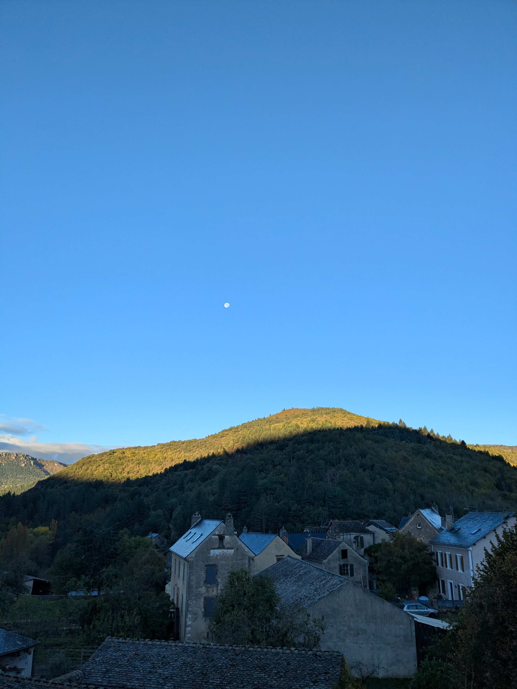
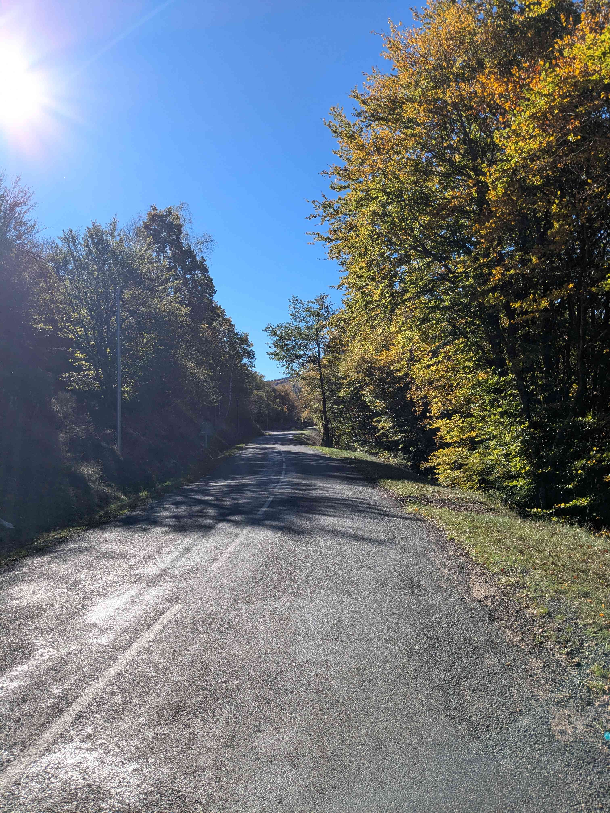
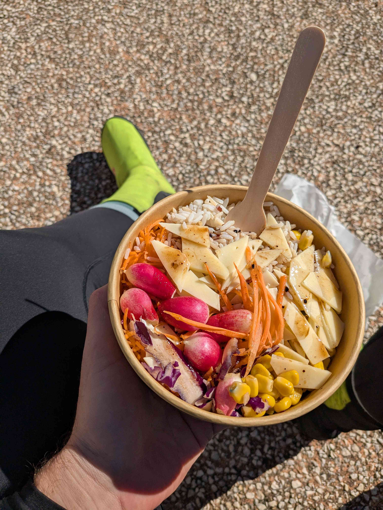
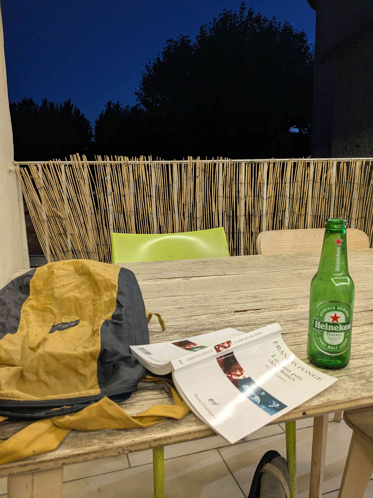

+++
title = "Cocurès - Saint-Martin-d'Ardèche"
date = "2026-10-28"
draft = "false"
+++

À peine le jour se lève-t-il sur le petit village de Cocurès, qu'il m'apparaît sans détour que la journée sera magnifique. Une belle lune ronde se détache encore du ciel bleu alors que nous finissons de petit-déjeuner, moi et mon voisin de tablée - fort agréable.

Impossible de partir avec le coupe-vent sur les épaules, dès neuf heures il fait déjà trop chaud. D'autant que la journée commence par une longue ascension vers un sommet incertain et sans doute inconnu des cartes.

À peine cette première difficulté dépassée, voilà que je bascule dans une autre vallée, profonde, encaissée, en bas de laquelle : Pont-de-Montvert.
Ah, quel souvenir doux-amer que celui de ce beau village, que je visitais malade, en avril dernier. Aujourd'hui, j'ai tout le loisir de le contempler sous le soleil d'automne, alors que le marché s'installe paisiblement. Pas question de s'attarder trop longuement néanmoins, la route est longue aujourd'hui.






De nouveau, une énième montée superfétatoire, comme les Cévennes en comptent beaucoup. Ces petites vallées semblent en effet bien difficiles à relier entre elles et bien souvent, c'est à grand renfort d'enjambements en tout genre que l'on passe de l'une à l'autre.

Heureusement pour moi, la récompense qui m'attend dépasse en tout point la difficulté de ce passage. De l'autre côté, je découvre un paysage nouveau, ouvert, immense ; des amoncellements de petits villages à flanc de collines égayent les forêts de pins et de châtaigniers, et il règne dans l'air l'odeur acre de la résine qui brûle.






La route abrupte serpente dans ce maquis et je comprends bien vite qu'elle m'entraîne irrémédiablement hors des Cévennes, vers la large vallée du Rhône. L'émotion est telle, sous le soleil blanc, enivré par ces arômes de bosquet, que je laisse échapper quelques larmes de plaisir. Je file à toute allure vers le fond de la vallée, avant de me rappeler qu'une simple erreur de conduite pourrait m'envoyer voir d'un peu trop près les galets du Lueche ou de la Cèze.

Une fois en bas et après un bon déjeuner, petit passage à vide jusqu'à Vallon-Pont-d'Arc. Un vent de face terrible me cloue sur place et la route est passante, laide et monotone.

Heureusement, dès les bords de l'Ardèche en vue, tout se transforme pour le mieux. La montée qui mène à la route panoramique est terrible, mais en haut, quel pied ! Toutes ces vues que l'on connaît si bien des méandres de la rivière, à portée de coup de manivelle !








La route et ses panoramas me bercent tranquillement et j'atteins, sans presque m'en rendre compte, mon point de chute, Saint-Martin-d'Ardèche. Si le village est charmant, il n'en demeure pas moins quasiment vide, mort, en dehors de la saison touristique. À part l'hôtel et un fast-food miteux, rien ne bouge ; le temps est suspendu aux gargouillis réguliers de la rivière.






Une seule chose à faire, donc : sortir un livre, s'offrir une bière et profiter du silence de la nuit tombante.

