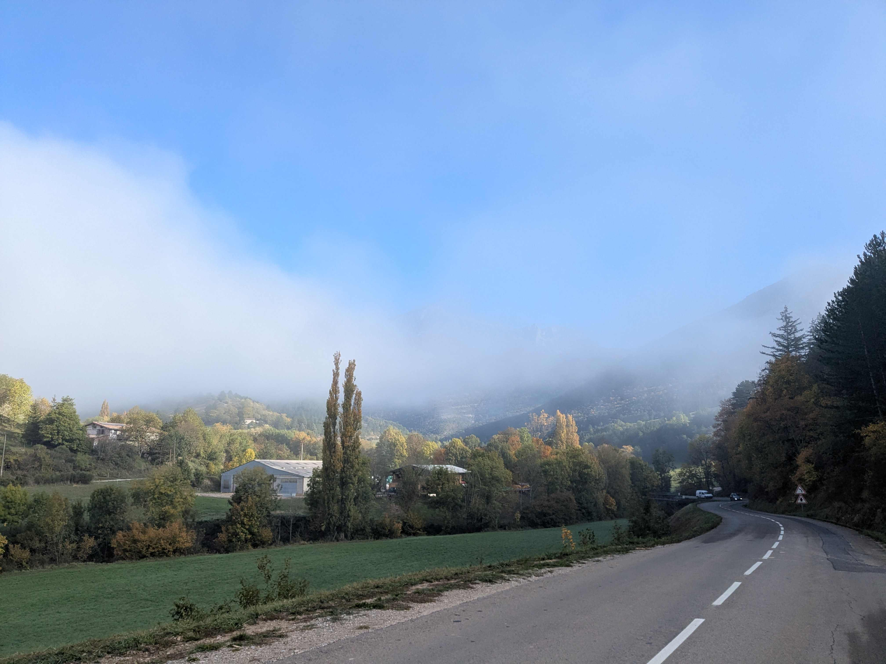
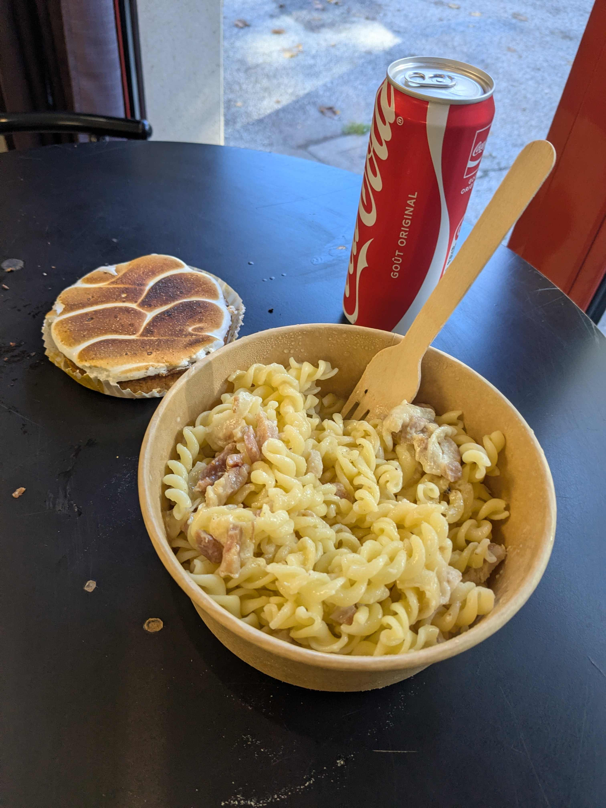
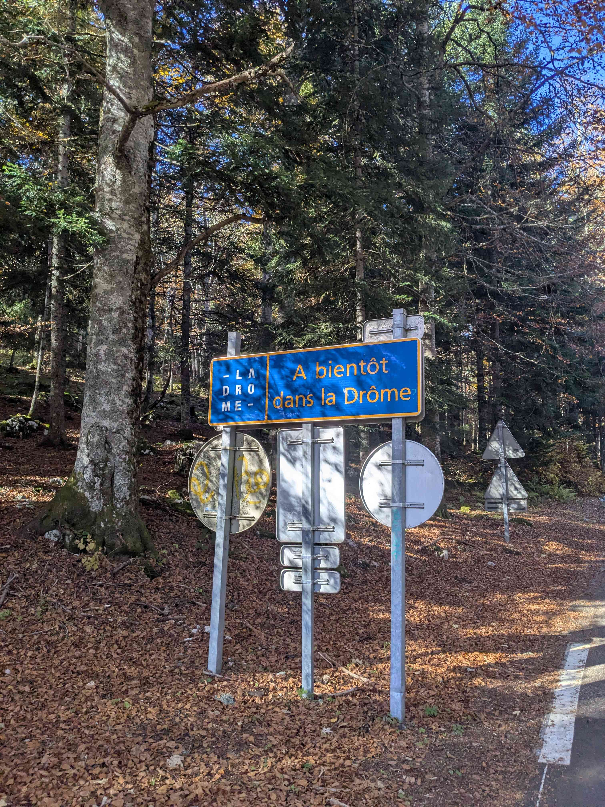

+++
title = "Die - Grenoble"
date = "2026-10-30"
draft = "false"
+++

L'air glacial des montagnes semble réussir à pénétrer dans ma chambre d'hôtel lorsque je me réveille ce matin. Vite habillé, je prends un petit-déjeuner léger mais vitaminé, puis j'échange ma tenue « de ville » pour celle « de route ».

Die est encore quelque peu endormie lorsque je me lance sur la voie du col du Rousset. Si la pente n'est pas très abrupte, la montée est longue ! Dix-huit kilomètres pour venir à bout de ce premier col, d'abord dans les nuages, puis sous un soleil réconfortant.








Je redescends au cœur du parc, dans le petit village de Saint-Agnan-en-Vercors, où, miracle, une petite boulangerie est ouverte. C'est plus qu'il n'en faut pour faire mon bonheur : j'y déjeune de pâtes réchauffées et d'une tartelette au citron. On me laisse manger au chaud, car dehors l'air est polaire et rester statique en lycra n'est pas franchement envisageable.

Après la reprise, le calme est de courte durée ; cette fois, c'est un col de dix kilomètres qui me cueille, plus raide que le premier. La semaine de vélo commence à se faire sentir, je peine un peu et me surprends même à râler dans les pourcentages les plus durs !






Au sommet, point de récompense, à peine un petit panneau dans la forêt indiquant la fin du supplice. Par chance, les arbres sont toujours aussi beaux, ainsi que la longue route ondulée qui me dépose à Villard-de-Lans.






De là à Grenoble, il n'y a plus qu'un pas. Une grande ligne droite - sur laquelle foncent malheureusement les autos -, puis, au bout, des lacets infinis jusque dans la vallée. Ça descend tellement fort que je commence à être gelé, sur cette paroi nord.

Enfin arrivé en ville, je rejoins l'amie qui m'héberge pour la nuit. Cette soirée, heureuse, a tout de même des airs de fin de voyage.

