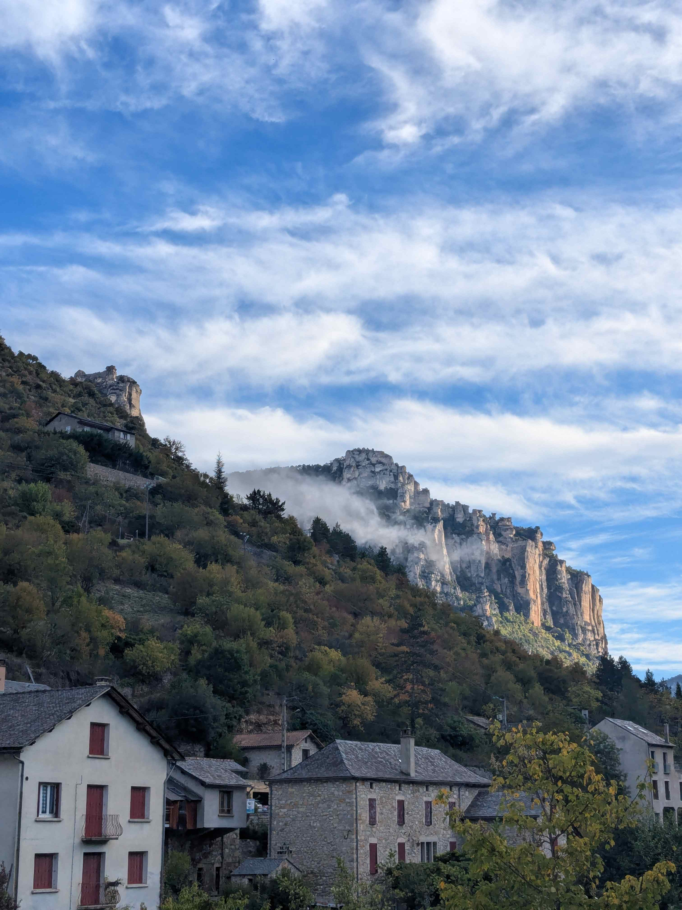
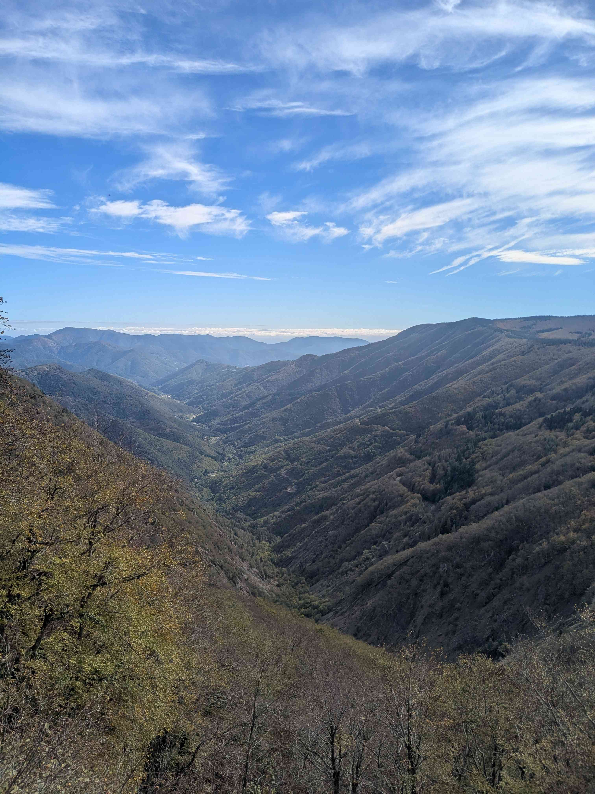
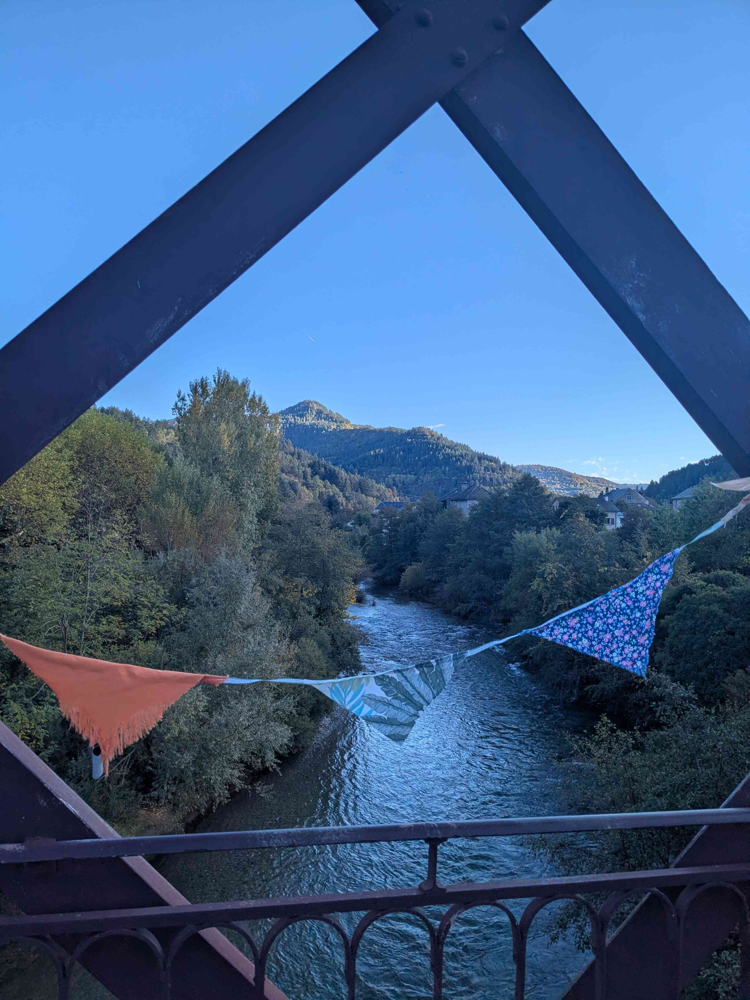
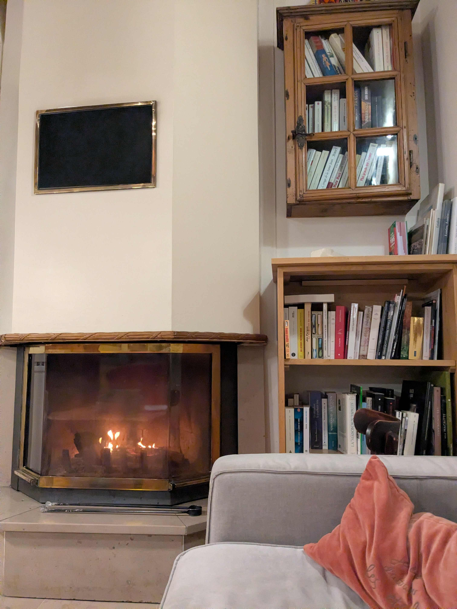

+++
title = "Peyreleau - Cocures"
date = "2026-10-27"
draft = "false"
+++

Two words. Two words and an off-the-cuff suggestion from an old local man I met for a few fleeting seconds by the roadside were all it took: “and why don’t you do Mont Aigoual?”

A brilliant idea, which will cost me an evening of replanning to produce a proper route. So it’s decided: this morning I set off for the Aigoual, via the Causse Noir road, reputed to be very beautiful.

If the first switchbacks, right out of the village—what am I saying, the gîte—are brutal, I nonetheless notice a new energy in my legs. After three days of pacing myself, the machinery is finally shaking off the rust, which lets me enjoy it a little more and suffer less on the first climb that comes along.






The morning mist still lingers lazily over the top of the plateaus, but fortunately today real warmth sets in quickly and chases the haze away. I wasn’t misled: the road is indeed very beautiful, made even more sublime by the fiery autumn colors.






From the village to the summit, I climb almost continuously for nearly fifty kilometers. But it isn’t _that_ hard; it’s mostly long. As if by some well-arranged coincidence, in the final kilometer of the ascent, it’s [the Pixies](https://youtu.be/OJ62RzJkYUo?is=jWXr7LrVyA0mkBic) who accompany me and give me a bit of grit to finish. On the last switchback, an elderly couple is having lunch facing the valley, picnic table and chairs included.

Having grown used to everything being closed at this season, I’m pleasantly surprised to find a small café at the summit, where I can eat on the terrace. For the first time since Saturday, I’m warm; the sun is beating down.
Fortunately, I don’t let myself be fooled; before descending, the jacket is essential—it’s actually only ten degrees.







A long and pleasant causse crossing later, and I’m already heading back toward Florac, via a dizzying descent that ends up making my brake discs howl. With my eardrums on fire, I arrive in this town I don’t like.

All the same, a stop is called for, because I’ve booked a hotel in Cocures, a charming little village but with nothing in it beyond said lodging. A quick stroll and an end-of-stage beer, no regrets about not sleeping here. The bad impression I had during the GR70 is confirmed.

So it’s without looking back that I head to my hotel, only twenty minutes away. This final effort under the—slight—influence of alcohol is quite destructive. No sooner have I completed the formalities than I find myself doing the starfish on a bed far too luxurious for a smelly, sweaty cyclist.






After a good shower, I treat myself to a tour of the village, but more importantly, a reading session by the fire...

