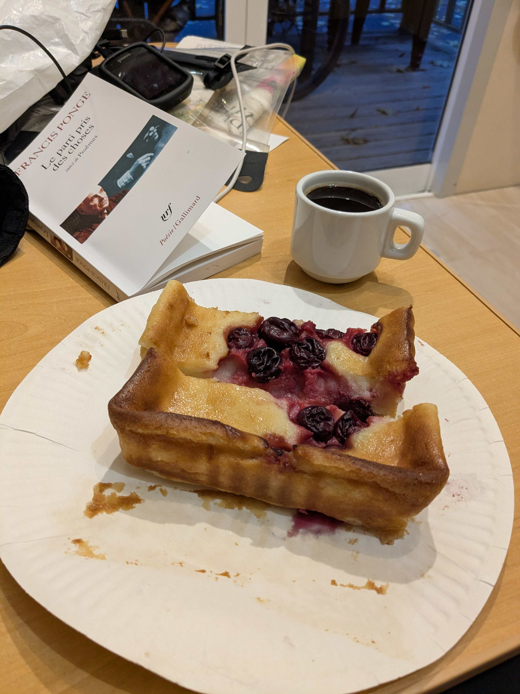
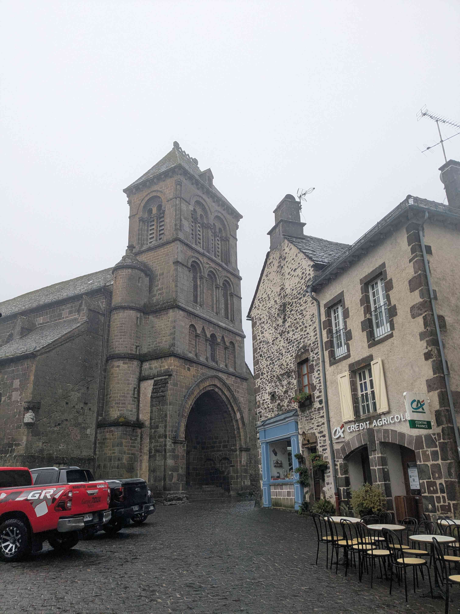
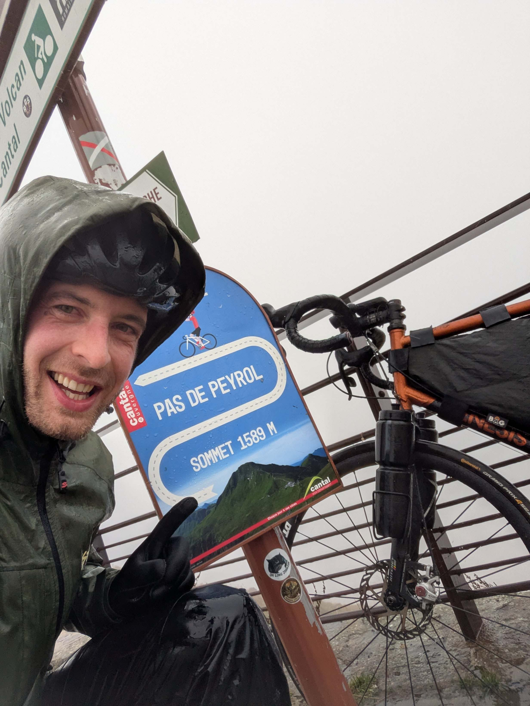
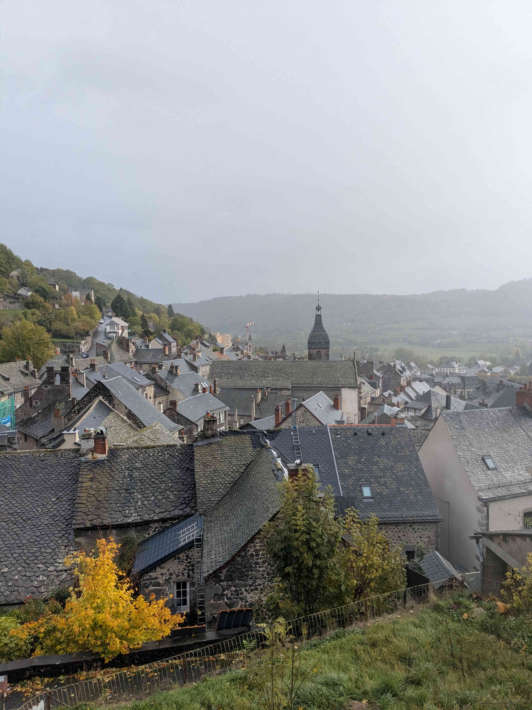
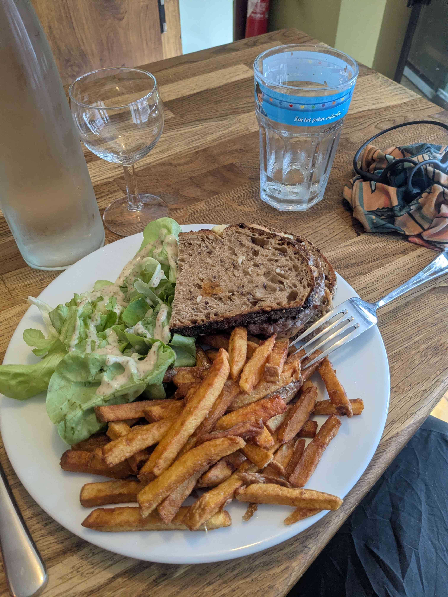
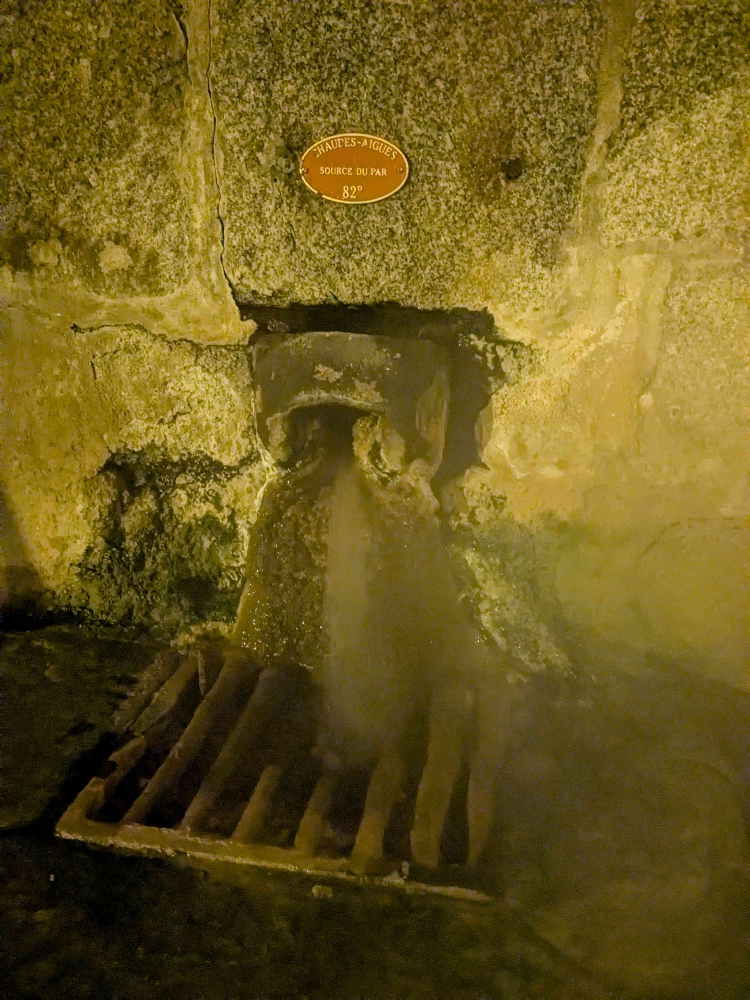
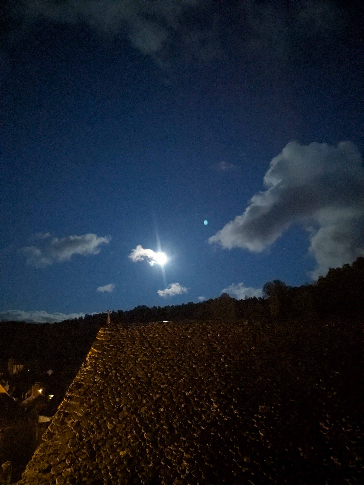

+++
title = "Pleaux - Chaudes-Aigues"
date = "2026-10-25"
draft = "false"
+++

La fête du village a été réussie. J'ai passé la soirée avec quelques anciens et la femme du maire, elle-même fleuriste de profession. Nous avons discuté de la pluie et du beau temps et, avant de partir, ces bonnes âmes ont eu la charmante idée de m'offrir une triple part de clafoutis aux cerises, ainsi que du café lyophilisé pour mon petit-déjeuner.

Ce matin, je savoure donc ce délicieux repas dans mon petit mobile-home, qui crépite sous une pluie intense. Car oui, les prévisions étaient quelque peu optimistes : ce sont en réalité dix millimètres de pluie qui vont s'abattre sur ma pauvre tête.

Face à ce constat désolant, le patron du camping me tient les propos les plus réconfortants : je peux rester gratuitement une nuit de plus à Pleaux !
Devant une proposition d'une telle gentillesse, n'importe quelle personne douée de raison aurait aussitôt accepté de passer la journée à se prélasser en bouquinant ou à assister au match de rugby du coin.

C'est pourquoi je prends la route quelques instants plus tard. C'est sans doute la mauvaise décision, mais l'idée de ne pas bouger aujourd'hui m'est insupportable. D'autant que c'est la journée du Puy Mary, que je rêve de gravir depuis des années : je trépigne d'impatience.

Me voilà donc bien servi. Je roule sous une pluie dense qui me glace les os. En moins d'une heure, toutes les couches de ma combinaison hors de prix ont été traversées par cette bruine perverse et je mouline sec pour ne pas geler sur place.

Arrivé à Salers, je m'accorde tout de même un petit café avec les habitués du coin, qui fument à l'intérieur ; un vieux souvenir d'enfance que je ne pensais plus connaître.

Après cette pause méritée, voilà enfin la montée, la fameuse, longue de plus de huit kilomètres, que j'attaque évidemment par son versant le plus dur. Je repense aux attaques de Pogačar sur ces mêmes pentes en 2024, sous un soleil de plomb, alors que j'y traîne ma misère sous la pluie battante. Les ruisseaux grondent et de multiples cascades jaillissent des talus.

Au sommet, la pluie redouble et le vent est effroyable. Je dois bloquer mon vélo pour une rapide photo-finish, afin qu'il ne parte pas à la renverse. Pas de temps à perdre : la photo prise, il faut redescendre, vite ! Là-haut, il ne fait que cinq degrés.

Est-ce une coïncidence ? Dès que ma roue avant découvre enfin un semblant de pense descendante, un morceau de rock bien senti se lance dans ma playlist ! La pluie me fouette le visage comme mille épines, mais je me laisse glisser à toute vitesse sur l'asphalte transformé en rivière. Mon pneu projette une immense gerbe d'eau qui me revient en pleine figure, mais qu'importe ; avec suffisamment d'abnégation, je redécouvre le plaisir vrai du vélo.

À Murat, je suis gelé par cette interminable descente. Je m'arrête pour manger, mais je suis en hypothermie : je déguste mes frites en tremblant comme une feuille. Inutile de traîner, je dois rouler.

Le vent et la pluie ne me laisseront guère de répit jusqu'à Chaudes-Aigues, où, cette fois, un hôtel m'attend. Douche brûlante, vêtements secs. Une petite visite du village s'impose, rapide mais agréable, avant de dîner, lire et me reposer.

Décidément, cette journée m'aura rappelé les plus dantesques étapes sur la route du Cap Nord !

