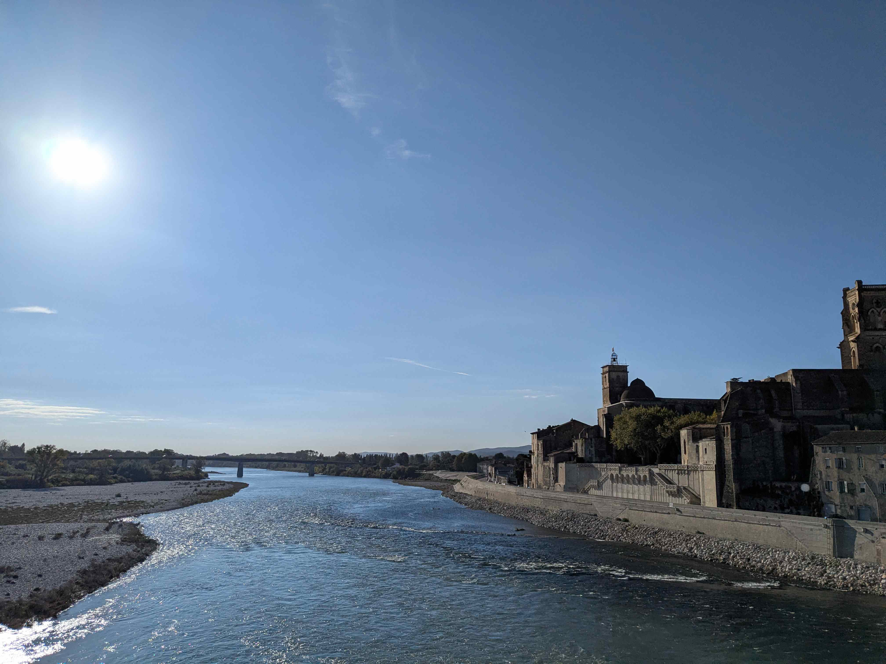
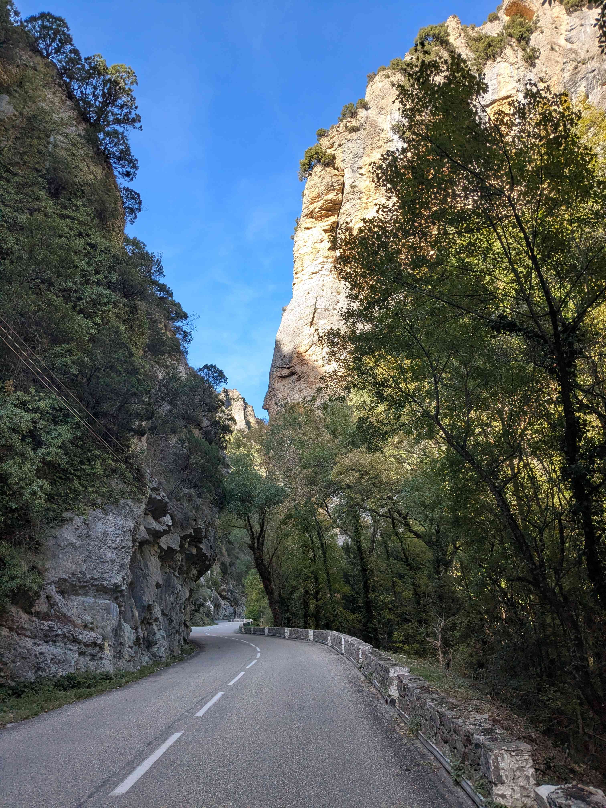
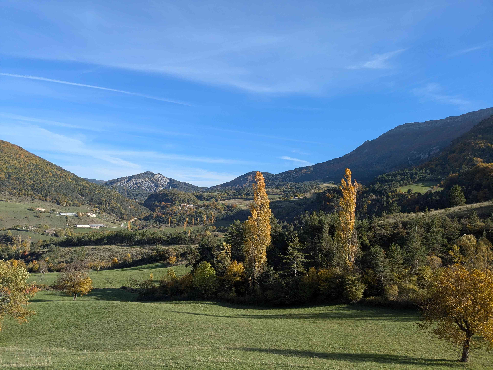
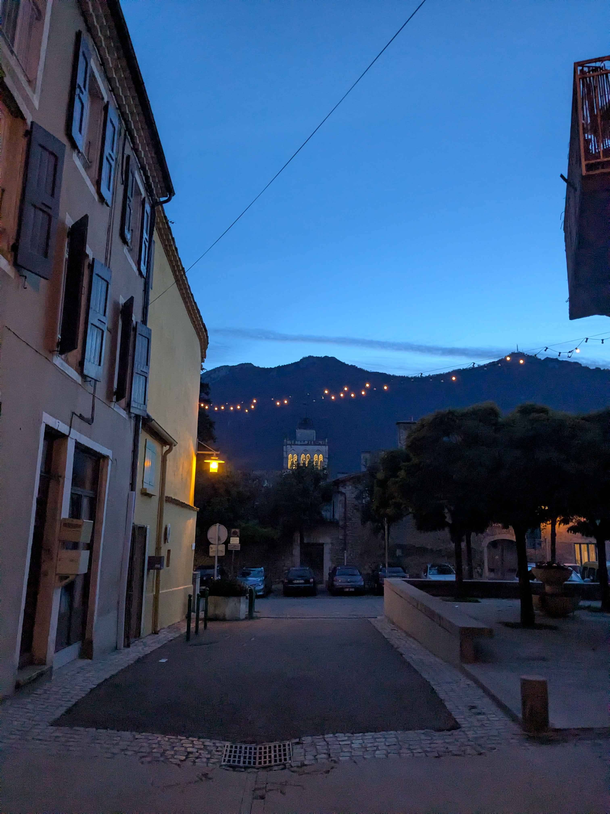

+++
title = "Saint-Martin-d'Ardèche - Die"
date = "2026-10-29"
draft = "false"
+++

La traversée de la vallée du Rhône me paraissait peu plaisante. Malheureusement, le tenancier de l'hôtel confirme mes craintes : les routes sont passantes et monotones.

Dans ce cas de figure, pas d'autre choix que de pousser le volume de la musique, prendre son mal en patience et écraser les pédales pour sortir le plus vite possible du bourbier. Pendant cinquante kilomètres, c'est effectivement assez pénible, malgré une traversée de Pont-Saint-Esprit engageante. Je me fais la réflexion qu'il s'agit de la première fois que je passe le Rhône à vélo. Allez, c'est un petit accomplissement qui compense un tant soit peu cette matinée par ailleurs décevante.

Ce n'est que lorsque j'arrive à Nyons que s'opère la magie du voyage. Tout à coup, les Baronnies Provençales dévoilent tout leur charme. L'air embaume le savon à la lavande, partout des étals d'olives noires frippées et rutilantes, et surtout, de l'huile, beaucoup d'huile. Bocaux petits ou grands, ronds ou allongés, sombres ou clairs, l'on ne sait où donner de la tête.







Ce charmant village est l'endroit idéal pour déjeuner et je ne m'en prive pas, d'autant que je quitte peu après la route principale, qui m'a tant agacé, pour partir à la découverte des petits lacets serrés des gorges des Trente Pas.

Cette fois, c'est la beauté du paysage qui éveille mes sens. De majestueuses falaises qui surplombent la route aux forêts pourpres, j'en oublierais presque la difficulté des deux petits cols qui s'offrent à moi.






En haut du deuxième, je savoure d'avance ce qui m'attend : une longue descente, très douce, presque trente kilomètres, qui m'amènera jusqu'à Die, pays bien connu de la Clairette.

Les vignes surplombant la Drôme, illuminées par un soleil déjà bas, sont un spectacle qui me laisse béat. La journée a néanmoins été longue et, en cette fin de séjour, je commence à fatiguer. Alors, une fois de plus, je monte un peu le son et c'est sur [Cissy Strut](https://youtu.be/4_iC0MyIykM?is=GKrbLsSxE4ma2Dxy) que se termine, en beauté, cette étape.







Die est un village magnifique, et je me délecte de sa visite. Entre petites boutiques de créateurs, librairie et bars sans prétention, je trouve largement mon bonheur pour la soirée.

À l'heure de préparer l'itinéraire de demain, pour rejoindre Grenoble, je prends finalement conscience de la difficulté que représentera la traversée du Vercors...